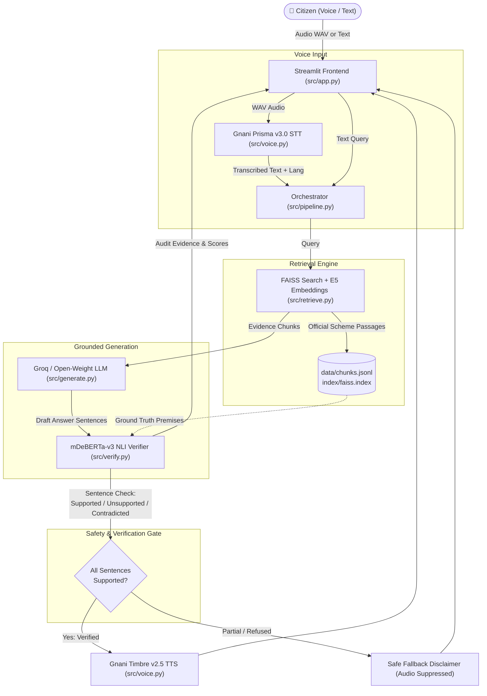

# Yojana Sahayak (योजना सहायक) — Voice Edition

> **"Ask in your language. Hear only what's verified."**  
> *अपनी भाषा में पूछें · केवल सत्यापित जानकारी सुनें*

<<<<<<< Updated upstream
Yojana Sahayak is a voice-first assistant for Indian government welfare schemes. It answers from official scheme text, checks every sentence of its own answer, and speaks only the sentences that pass the check. If an answer cannot be verified, it says so instead of guessing.

Built by **Akriti Sengar** and **Bhawna Rani** for the Gnani AI challenge.

> Yojana Sahayak is an independent educational information assistant. It is not a government website or service. Scheme rules and eligibility can change, so always confirm details on the linked official source before applying.

## Why this exists

A language model can sound confident and still be wrong. For welfare schemes, a wrong answer about who is eligible or how much is paid can cost someone a benefit. This project adds a verification step between the model and the user, so only answers that are supported by official text are read out.

## How it works

```
Voice or text question
        |
        v
Gnani Prisma v3.0 (speech to text)
        |
        v
multilingual-e5-base embeddings  -->  FAISS search over official
                                      bilingual scheme sections
        |
        v
Open-weight Llama writes a short answer from the retrieved text
        |
        v
mDeBERTa-v3 NLI checks each sentence against the retrieved text
        |
        +--> Supported sentences  --> Gnani Timbre v2.5 speaks them
        |
        +--> Not verified         --> fixed safe fallback message
```

1. **Speech to text.** Gnani Prisma v3.0 transcribes the question. Prisma v2.5 is the documented fallback when v3 is unavailable. The REST call uses `language_code=indic-auto`, `multi_lang_codes=hi-IN,en-IN` and `keywords` (called `keyterms` inside the project).
2. **Retrieval.** `intfloat/multilingual-e5-base` embeds the question (`query:` prefix) and the scheme sections (`passage:` prefix). A FAISS `IndexFlatIP` index over normalised embeddings returns the best-matching official sections in English and Hindi.
3. **Answer generation.** An open-weight Llama model writes a short answer using only the retrieved sections. Primary design: Llama through Groq. Permitted open-weight fallback: local Ollama with Llama 3.1 8B. The other synopsis-approved fallback is Gemini through Google AI Studio, which is **not** open-weight and must be disclosed if used.
4. **Verification.** `MoritzLaurer/mDeBERTa-v3-base-xnli-multilingual-nli-2mil7` checks every sentence of the answer against the retrieved text. Each sentence gets a label, and the answer gets an overall groundedness score.
5. **Speech output.** Gnani Timbre v2.5 speaks only the sentences labelled **Supported**, using Nalini (`hi-IN`) for Hindi and Kaveri (`en-IN`) for English.
6. **Safe fallback.** If the answer cannot be verified, the app shows and speaks: *"I could not verify a complete answer from the available official sources. Please check the scheme's official website."*

## What you see in the app

- Voice input or typed questions, in English or Hindi, with a language toggle and dark mode
- The transcript, marked "Asked by voice" when a question was spoken
- A verified or "couldn't verify" label on every answer
- The groundedness score and a per-sentence check (Supported / Unsupported / Contradicted)
- The official scheme sections the answer was built from, each with a link to the official source
- Audio playback of verified answers (WAV)

## Tech stack

| Part | Tool |
|---|---|
| Speech to text | Gnani Prisma v3.0 (v2.5 fallback) |
| Embeddings | `intfloat/multilingual-e5-base` |
| Vector search | FAISS `IndexFlatIP` |
| Answer generation | Llama via Groq (Ollama Llama 3.1 8B fallback) |
| Verification | `MoritzLaurer/mDeBERTa-v3-base-xnli-multilingual-nli-2mil7` |
| Text to speech | Gnani Timbre v2.5 (Nalini `hi-IN`, Kaveri `en-IN`) |
| Interface | Streamlit |

## Project structure

```
app.py            Streamlit app
src/              ingestion, retrieval, generation, verification, speech
data/             official scheme records (see data/SCHEME_DATA_FORMAT.md)
index/            FAISS index files
eval/             evaluation questions and scripts
scripts/          helper scripts, including real_smoke.py
tests/            offline unit tests
results/          evaluation outputs
assets/           images used by the app
```
=======
Yojana Sahayak is a voice-first, evidence-grounded AI information assistant for Indian government welfare schemes. It enables citizens to ask questions by voice or text in **Hindi** or **English**, retrieves official government scheme documents, generates concise factual answers, and runs sentence-level Natural Language Inference (NLI) verification before speaking the response. 

If any part of an answer cannot be verified against official source documents, the system refuses to guess, highlights unsupported claims in the UI, and never speaks unverified facts aloud.

---
>>>>>>> Stashed changes

## 🌟 Key Features

<<<<<<< Updated upstream
1. Use Python 3.11 or 3.12 and install the requirements:
   ```
   pip install -r requirements.txt
   ```
2. Copy `.env.example` to `.env` and enter your Gnani and Groq credentials.
3. Make sure `data/schemes.jsonl` contains official English and Hindi records. The format is described in `data/SCHEME_DATA_FORMAT.md`.
4. Build the index and test retrieval:
   ```
   python -m src.ingest
   python -m src.retrieve
   ```
5. Run the offline tests:
   ```
   python -m pytest -q
   ```
6. Run one real speech-to-text and text-to-speech smoke test. Read the confirmation prompt first, because it makes real API calls:
   ```
   python scripts/real_smoke.py
   ```
7. Start the app:
   ```
   streamlit run app.py
   ```

Note: Groq's free Developer access no longer includes Llama 3.3 70B. Check which Llama models your account can use, or switch to the Ollama fallback.

## Evaluation and limits

- Retrieval, answer verification and speech output are working end to end in the demo.
- Formal evaluation numbers (retrieval quality, verifier precision and recall, response time) are not reported here yet. They will be added only after being measured on the final data with the final code. Run `python -m eval.validate_scope` to check the data and question split before measuring.
- A high groundedness score means the answer matches the retrieved official text. It does not guarantee that the scheme rules are current. The source text is only as up to date as the data in `data/`.
- Scheme coverage is limited to the records in `data/`. Questions outside that coverage should return the safe fallback, not a guess.
- The verifier is an NLI model. It can make mistakes, especially on Hindi sentences and on numbers.

## Team

- Akriti Sengar
- Bhawna Rani

## License

MIT. See [LICENSE](LICENSE).
=======
- **🎙️ Voice-First Bilingual Interface**: Speak naturally in Hindi or English using integrated voice recording powered by **Gnani Prisma v3.0** speech-to-text.
- **🔍 Grounded Retrieval (RAG)**: Multilingual semantic search across 20 official welfare schemes using `intfloat/multilingual-e5-base` embeddings and **FAISS** index.
- **🛡️ Sentence-Level NLI Verification**: Uses `mDeBERTa-v3` cross-encoder NLI to verify every sentence. Evaluates groundedness and flags statements as *Supported*, *Unsupported*, or *Contradicted*.
- **🔊 Verified-Only Audio Playback**: Only sentences verified as *Supported* are spoken aloud using **Gnani Timbre v2.5** TTS (Nalini for Hindi, Kaveri for English). Unverified sentences trigger a safe, transparent fallback disclaimer.
- **📑 Side-by-Side Evidence Panel**: Real-time display showing retrieved official excerpts, source URLs, groundedness scores, and sentence-by-sentence audit checks.
- **🌓 Accessible UI**: Built with Streamlit featuring light/dark mode, indigo palette, popular quick prompts, and bilingual interface localization.

---

## 🏗️ System Architecture



---

## 📦 Tech Stack & Components

| Component | Technology | Role |
|-----------|------------|------|
| **Speech-to-Text (STT)** | Gnani Prisma v3.0 (`hi-IN`, `en-IN`, `indic-auto`) | Transcribes voice input with domain keyterms boost |
| **Embeddings & Vector Search** | `intfloat/multilingual-e5-base` + FAISS (`IndexFlatIP`) | Semantic retrieval with scheme-aware ranking boost |
| **Answer Generation** | `openai/gpt-oss-120b` via Groq API | Evidence-grounded generation adhering strictly to context |
| **NLI Verification** | `MoritzLaurer/mDeBERTa-v3-base-xnli-multilingual-nli-2mil7` | Sentence-by-sentence entailment/contradiction validation |
| **Text-to-Speech (TTS)** | Gnani Timbre v2.5 (`Nalini` Hindi / `Kaveri` English) | Audio synthesis for verified answers with number normalization |
| **User Interface** | Streamlit (Python) | Single integrated composer, audio player, audit panel, theming |

---

## 📋 Prerequisites

- **Operating System**: macOS, Linux, or Windows.
- **Python**: `3.11` or `3.12` recommended.
- **API Keys**:
  - **Gnani.ai API Keys**: Required for STT (`GNANI_STT_API_KEY`) and TTS (`GNANI_TTS_API_KEY`).
  - **Groq API Key**: Required for LLM answer generation (`GROQ_API_KEY`).
  - *(Optional)*: Google AI Studio key (`GEMINI_API_KEY`) or local Ollama (`llama3.1:8b`) if using non-Groq providers.

---

## 🚀 Quickstart Guide for Developers

### Step 1: Clone the Repository

```bash
git clone https://github.com/bhawnarani/yojana-sahayak-voice.git
cd yojana-sahayak-voice
```

### Step 2: Set Up Virtual Environment

```bash
python3 -m venv .venv
source .venv/bin/activate
# On Windows: .venv\Scripts\activate
```

### Step 3: Install Dependencies

```bash
pip install --upgrade pip
pip install -r requirements.txt
```

### Step 4: Configure Environment Variables

Copy the example environment template:

```bash
cp .env.example .env
```

Open `.env` in an editor and enter your credentials:

```ini
# Gnani Voice Credentials
GNANI_STT_API_KEY=your_gnani_stt_key
GNANI_TTS_API_KEY=your_gnani_tts_key
GNANI_STT_URL=https://api.vachana.ai/stt/v3
GNANI_TTS_URL=https://api.vachana.ai/api/v1/tts/inference
PRISMA_STT_MODEL=prisma-v3.0
PRISMA_LANGUAGE_CODE=hi-IN,en-IN

# LLM Generation (Groq default)
GROQ_API_KEY=your_groq_api_key
LLM_PROVIDER=groq
LLM_MODEL=openai/gpt-oss-120b

# Pipeline & Verification Parameters
DRY_RUN=0
TTS_CACHE=1
MIN_SIMILARITY=0.30
T_ENT=0.60
T_CON=0.50
```

> **Note on Offline/Dry-Run Mode**: Setting `DRY_RUN=1` lets you test the pipeline and UI without making external API calls to Gnani or Groq.

### Step 5: Ingest Scheme Data & Build Retrieval Index

The repository includes curated bilingual data for 20 major schemes in `data/schemes.csv` and `data/schemes.jsonl`. Generate chunks and the FAISS vector index:

```bash
# 1. Parse and chunk official scheme sources
python -m src.ingest

# 2. Compute embeddings and build the FAISS index
python -m src.retrieve
```

This generates `data/chunks.jsonl` (48 chunks across 20 schemes) and creates `index/faiss.index`.

### Step 6: Verify Setup & Run Tests

Check your environment and dependencies:

```bash
python scripts/check_setup.py
```

Validate scheme data and evaluation scope (verifies 20 bilingual schemes and 40-question test split):

```bash
python -m eval.validate_scope
```

Run automated unit and regression tests:

```bash
pytest
```

*(All 44 test cases across verification contracts, voice cache, pipeline, and normalizations should pass).*

### Step 7: Launch the Application

Start the Streamlit application:

```bash
streamlit run src/app.py
```

Open your browser at **`http://localhost:8501`**.

---

## 📁 Repository Structure

```
yojana-sahayak-voice/
├── README.md               # Developer documentation and setup guide
├── SOLUTION_PITCH.md       # One-page executive solution pitch for submission
├── requirements.txt        # Python package dependencies
├── .env.example            # Environment variables template
├── assets/                 # SVGs and UI branding assets
├── data/                   # Government scheme source data
│   ├── schemes.csv         # Structured table of 20 schemes
│   ├── schemes.jsonl       # Bilingual scheme documents (English & Hindi)
│   ├── chunks.jsonl        # Segmented passages for retrieval
│   └── keyterms.json       # Scheme aliases & keyterms for STT boosting
├── index/                  # FAISS search index & metadata
│   ├── faiss.index         # 768-dim vector index
│   ├── chunks.jsonl        # Indexed chunk records
│   └── manifest.json       # Index signature & corpus hash
├── src/                    # Core application source code
│   ├── app.py              # Streamlit web application & UI
│   ├── pipeline.py         # End-to-end question answering pipeline
│   ├── retrieve.py         # FAISS retrieval & multilingual E5 embeddings
│   ├── generate.py         # LLM prompt orchestration & clean answer formatting
│   ├── verify.py           # mDeBERTa-v3 sentence-level NLI verification
│   └── voice.py            # Gnani Prisma STT & Timbre TTS integration
├── eval/                   # Evaluation scripts and test datasets
│   ├── eval_questions.jsonl# 40 standard evaluation questions (30 answerable / 10 unanswerable)
│   ├── evaluate_retrieval.py # Recall@k and retrieval accuracy benchmarking
│   └── validate_scope.py   # Corpus and evaluation split verification
├── scripts/                # Developer utilities and smoke tests
│   ├── check_setup.py      # Environment and dependency validator
│   ├── demo_warmup.py      # Preloads models into memory for fast demo response
│   └── real_smoke.py       # Live STT/TTS API test script
└── tests/                  # Pytest test suite (44 automated test cases)
```

---

## 🛠️ Common Developer FAQs & Troubleshooting

### 1. macOS Segmentation Fault during Model Loading
On Apple Silicon or macOS systems, native numerical libraries (`OpenMP`, `MKL`, `Accelerate`) can conflict when Streamlit spawns threads. `src/app.py` already includes stability guards at the top of the file:
```python
os.environ["OMP_NUM_THREADS"] = "1"
os.environ["MKL_NUM_THREADS"] = "1"
os.environ["OPENBLAS_NUM_THREADS"] = "1"
os.environ["TOKENIZERS_PARALLELISM"] = "false"
```
If executing standalone Python scripts directly on macOS, ensure these environment variables are set.

### 2. Microphones / Voice Input in Streamlit
`st.chat_input(accept_audio=True)` requires browser microphone permission. When prompted by your browser on `localhost:8501`, grant microphone access. Ensure the recording is under 30 seconds.

### 3. Missing or Decommissioned Groq Models
If Groq retires a specific model identifier, update `LLM_MODEL` in `.env` to any active Groq chat model (e.g., `openai/gpt-oss-120b`, `llama-3.3-70b-versatile`), or switch `LLM_PROVIDER=ollama` for zero-cost offline local inference.

### 4. Re-indexing after Changing Scheme Text
If you edit `data/schemes.csv` or `data/schemes.jsonl`, rebuild the vector store by running:
```bash
python -m src.ingest && python -m src.retrieve
```
The retrieval engine automatically detects corpus signature mismatches and rebuilds the index safely.

---

## 📜 License & Disclaimer

Yojana Sahayak is an educational and informational research prototype developed for welfare awareness. It is not an official government service. Users should confirm all rules and formal eligibility with the relevant ministry portals linked in the app's evidence panel.
>>>>>>> Stashed changes
