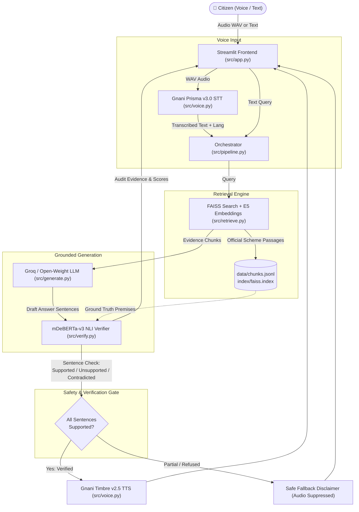

# Yojana Sahayak (योजना सहायक) — Voice Edition

> **"Ask in your language. Hear only what's verified."**  
> *अपनी भाषा में पूछें · केवल सत्यापित जानकारी सुनें*

Yojana Sahayak is a voice-first, evidence-grounded AI information assistant for Indian government welfare schemes. It enables citizens to ask questions by voice or text in **Hindi** or **English**, retrieves official government scheme documents, generates concise factual answers, and runs sentence-level Natural Language Inference (NLI) verification before speaking the response. 

Built by **Akriti Sengar** and **Bhawna Rani** for the Gnani AI challenge.

If any part of an answer cannot be verified against official source documents, the system refuses to guess, highlights unsupported claims in the UI, and never speaks unverified facts aloud.

---

## 🌟 Key Features

- **🎙️ Voice-First Bilingual Interface**: Speak naturally in Hindi or English using integrated voice recording powered by **Gnani Prisma v3.0** speech-to-text.
- **🔍 Grounded Retrieval (RAG)**: Multilingual semantic search across 20 official welfare schemes using `intfloat/multilingual-e5-base` embeddings and **FAISS** index.
- **🛡️ Sentence-Level NLI Verification**: Uses `mDeBERTa-v3` cross-encoder NLI to verify every sentence. Evaluates groundedness and flags statements as *Supported*, *Unsupported*, or *Contradicted*.
- **🔊 Verified-Only Audio Playback**: Only sentences verified as *Supported* are spoken aloud using **Gnani Timbre v2.5** TTS (Nalini for Hindi, Kaveri for English). Unverified sentences trigger a safe, transparent fallback disclaimer.
- **📑 Side-by-Side Evidence Panel**: Real-time display showing retrieved official excerpts, source URLs, groundedness scores, and sentence-by-sentence audit checks.
- **🌓 Accessible UI**: Built with Streamlit featuring light/dark mode, indigo palette, popular quick prompts, and bilingual interface localization.

---

## 🏗️ System Architecture



---

## 📦 Tech Stack & Components

| Component | Technology | Role |
|-----------|------------|------|
| **Speech-to-Text (STT)** | Gnani Prisma v3.0 (`hi-IN`, `en-IN`, `indic-auto`) | Transcribes voice input with domain keyterms boost |
| **Embeddings & Vector Search** | `intfloat/multilingual-e5-base` + FAISS (`IndexFlatIP`) | Semantic retrieval with scheme-aware ranking boost |
| **Answer Generation** | `openai/gpt-oss-120b` via Groq API | Evidence-grounded generation adhering strictly to context |
| **NLI Verification** | `MoritzLaurer/mDeBERTa-v3-base-xnli-multilingual-nli-2mil7` | Sentence-by-sentence entailment/contradiction validation |
| **Text-to-Speech (TTS)** | Gnani Timbre v2.5 (`Nalini` Hindi / `Kaveri` English) | Audio synthesis for verified answers with number normalization |
| **User Interface** | Streamlit (Python) | Single integrated composer, audio player, audit panel, theming |

---

## 📋 Prerequisites

- **Operating System**: macOS, Linux, or Windows.
- **Python**: `3.11` or `3.12` recommended.
- **API Keys**:
  - **Gnani.ai API Keys**: Required for STT (`GNANI_STT_API_KEY`) and TTS (`GNANI_TTS_API_KEY`).
  - **Groq API Key**: Required for LLM answer generation (`GROQ_API_KEY`).
  - *(Optional)*: Google AI Studio key (`GEMINI_API_KEY`) or local Ollama (`llama3.1:8b`) if using non-Groq providers.

---

## 🚀 Quickstart Guide for Developers

### Step 1: Clone the Repository

```bash
git clone https://github.com/Tashuuuu/yojana-sahayak.git
cd yojana-sahayak-voice
```

### Step 2: Set Up Virtual Environment

```bash
python3 -m venv .venv
source .venv/bin/activate
# On Windows: .venv\Scripts\activate
```

### Step 3: Install Dependencies

```bash
pip install --upgrade pip
pip install -r requirements.txt
```

### Step 4: Configure Environment Variables

Copy the example environment template:

```bash
cp .env.example .env
```

Open `.env` in an editor and enter your credentials:

```ini
# Gnani Voice Credentials
GNANI_STT_API_KEY=your_gnani_stt_key
GNANI_TTS_API_KEY=your_gnani_tts_key
GNANI_STT_URL=https://api.vachana.ai/stt/v3
GNANI_TTS_URL=https://api.vachana.ai/api/v1/tts/inference
PRISMA_STT_MODEL=prisma-v3.0
PRISMA_LANGUAGE_CODE=hi-IN,en-IN

# LLM Generation (Groq default)
GROQ_API_KEY=your_groq_api_key
LLM_PROVIDER=groq
LLM_MODEL=openai/gpt-oss-120b

# Pipeline & Verification Parameters
DRY_RUN=0
TTS_CACHE=1
MIN_SIMILARITY=0.30
T_ENT=0.60
T_CON=0.50
```

> **Note on Offline/Dry-Run Mode**: Setting `DRY_RUN=1` lets you test the pipeline and UI without making external API calls to Gnani or Groq.

### Step 5: Ingest Scheme Data & Build Retrieval Index

The repository includes curated bilingual data for 20 major schemes in `data/schemes.csv` and `data/schemes.jsonl`. Generate chunks and the FAISS vector index:

```bash
# 1. Parse and chunk official scheme sources
python -m src.ingest

# 2. Compute embeddings and build the FAISS index
python -m src.retrieve
```

This generates `data/chunks.jsonl` (48 chunks across 20 schemes) and creates `index/faiss.index`.

### Step 6: Verify Setup & Run Tests

Check your environment and dependencies:

```bash
python scripts/check_setup.py
```

Validate scheme data and evaluation scope (verifies 20 bilingual schemes and 40-question test split):

```bash
python -m eval.validate_scope
```

Run automated unit and regression tests:

```bash
pytest
```

*(All 44 test cases across verification contracts, voice cache, pipeline, and normalizations should pass).*

### Step 7: Launch the Application

Start the Streamlit application:

```bash
streamlit run src/app.py
```

Open your browser at **`http://localhost:8501`**.

---

## 📁 Repository Structure

```
yojana-sahayak-voice/
├── README.md               # Developer documentation and setup guide
├── SOLUTION_PITCH.md       # One-page executive solution pitch for submission
├── requirements.txt        # Python package dependencies
├── .env.example            # Environment variables template
├── assets/                 # SVGs and UI branding assets
├── data/                   # Government scheme source data
│   ├── schemes.csv         # Structured table of 20 schemes
│   ├── schemes.jsonl       # Bilingual scheme documents (English & Hindi)
│   ├── chunks.jsonl        # Segmented passages for retrieval
│   └── keyterms.json       # Scheme aliases & keyterms for STT boosting
├── index/                  # FAISS search index & metadata
│   ├── faiss.index         # 768-dim vector index
│   ├── chunks.jsonl        # Indexed chunk records
│   └── manifest.json       # Index signature & corpus hash
├── src/                    # Core application source code
│   ├── app.py              # Streamlit web application & UI
│   ├── pipeline.py         # End-to-end question answering pipeline
│   ├── retrieve.py         # FAISS retrieval & multilingual E5 embeddings
│   ├── generate.py         # LLM prompt orchestration & clean answer formatting
│   ├── verify.py           # mDeBERTa-v3 sentence-level NLI verification
│   └── voice.py            # Gnani Prisma STT & Timbre TTS integration
├── eval/                   # Evaluation scripts and test datasets
│   ├── eval_questions.jsonl# 40 standard evaluation questions (30 answerable / 10 unanswerable)
│   ├── evaluate_retrieval.py # Recall@k and retrieval accuracy benchmarking
│   └── validate_scope.py   # Corpus and evaluation split verification
├── scripts/                # Developer utilities and smoke tests
│   ├── check_setup.py      # Environment and dependency validator
│   ├── demo_warmup.py      # Preloads models into memory for fast demo response
│   └── real_smoke.py       # Live STT/TTS API test script
└── tests/                  # Pytest test suite (44 automated test cases)
```

---

## 🛠️ Common Developer FAQs & Troubleshooting

### 1. macOS Segmentation Fault during Model Loading
On Apple Silicon or macOS systems, native numerical libraries (`OpenMP`, `MKL`, `Accelerate`) can conflict when Streamlit spawns threads. `src/app.py` already includes stability guards at the top of the file:
```python
os.environ["OMP_NUM_THREADS"] = "1"
os.environ["MKL_NUM_THREADS"] = "1"
os.environ["OPENBLAS_NUM_THREADS"] = "1"
os.environ["TOKENIZERS_PARALLELISM"] = "false"
```
If executing standalone Python scripts directly on macOS, ensure these environment variables are set.

### 2. Microphones / Voice Input in Streamlit
`st.chat_input(accept_audio=True)` requires browser microphone permission. When prompted by your browser on `localhost:8501`, grant microphone access. Ensure the recording is under 30 seconds.

### 3. Missing or Decommissioned Groq Models
If Groq retires a specific model identifier, update `LLM_MODEL` in `.env` to any active Groq chat model (e.g., `openai/gpt-oss-120b`, `llama-3.3-70b-versatile`), or switch `LLM_PROVIDER=ollama` for zero-cost offline local inference.

### 4. Re-indexing after Changing Scheme Text
If you edit `data/schemes.csv` or `data/schemes.jsonl`, rebuild the vector store by running:
```bash
python -m src.ingest && python -m src.retrieve
```
The retrieval engine automatically detects corpus signature mismatches and rebuilds the index safely.

---
## Team

- Akriti Sengar
- Bhawna Rani

---
## 📜 License & Disclaimer

Yojana Sahayak is an educational and informational research prototype developed for welfare awareness. It is not an official government service. Users should confirm all rules and formal eligibility with the relevant ministry portals linked in the app's evidence panel.
